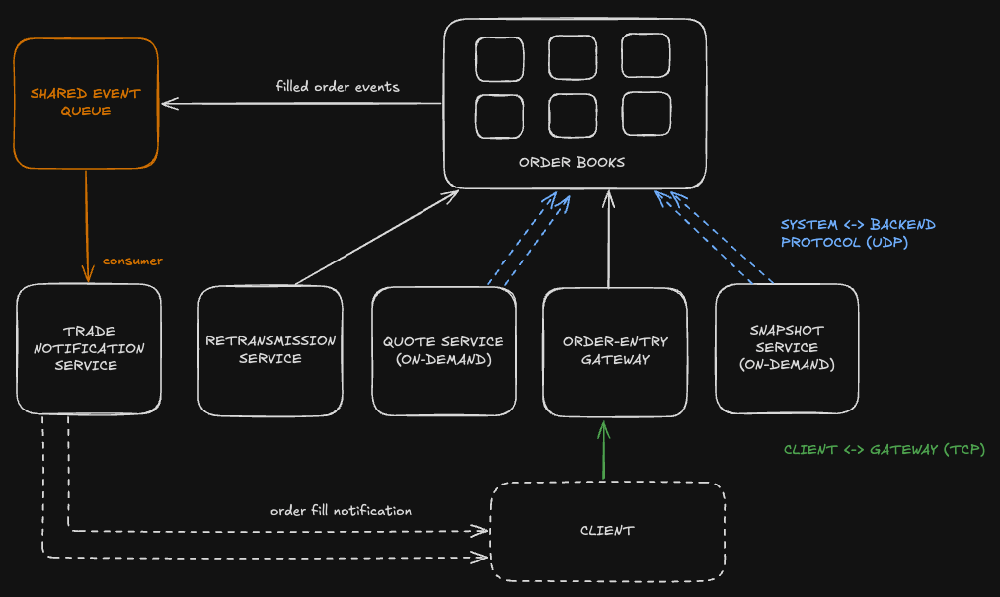

# Stock Exchange Core (C++)

A high-performance, simplified stock exchange core implementation written in C++20.

## Problem Statement

Modern financial exchanges need to process hundreds of thousands of orders per second with microsecond latency while maintaining data consistency and fault tolerance. This project tackles the fundamental challenges:

- **Order Matching**: Efficiently match buy and sell orders using different algorithms
- **Market Data**: Real-time distribution of quotes and trade notifications
- **Fault Tolerance**: Handle message loss and system recovery
- **Concurrency**: Thread-safe processing of concurrent order flows
- **Protocol Design**: Efficient binary message formats for high-frequency trading

## Architecture Overview



## Project Structure

```
├── src/
│   ├── core/           # Order matching and book management
│   ├── services/       # Exchange services (gateway, quotes, etc.)
│   ├── client/         # Client implementations (market maker, noise trader)
│   └── queue/          # Event processing
├── include/            # Header files
├── tests/              # Unit and performance tests
└── Makefile           # Build configuration
```

## Key Features & Design Decisions


1. **Three-Tier Protocol Architecture**: [`ClientProtocol`](include/common/message.h) (24 bytes on the wire) carries minimal order data over the network, [`SystemProtocol`](include/common/message.h) (44 bytes on the wire) adds sequencing and integrity metadata for internal processing, and [`BatchSystemProtocol`](include/common/message.h) (1000 bytes) aggregates multiple orders for efficient bulk operations and reduced system calls.

2. **Dual-Strategy Price Levels**: The [`PriceLevel`](include/core/price_level.h) class supports both time-priority (FIFO) and size-priority (Pro-Rata) matching, allowing flexibility in match execution

3. **Batch Protocol**: The [`BatchSystemProtocol`](include/common/message.h) uses a fixed 1000-byte array with inline serialization, holding up to 22 orders per batch.

4. **Singleton Services with Thread Safety**: Services like [`RetransmissionService`](include/services/retransmission_service.h) use the singleton pattern with proper mutex protection, ensuring system-wide consistency while avoiding global state issues.

5. **Transaction Id and Sequence Number Gap Detection**: The [`OrderBook::process`](src/core/order_book.cpp) method implements intelligent gap detection, automatically requesting retransmissions or snapshots based on sequence number discontinuities.

6. **Event-Driven Architecture**: The [`EventQueue`](include/queue/event_queue.h) decouples order processing from client notifications, allowing for asynchronous trade reporting without blocking the matching engine.

7. **Condition-Variable Hot Path**: Neither the [`OrderEntryGateway`](src/services/order_entry_gateway.cpp) batch thread nor the [`TradeNotificationService`](src/services/trade_notification_service.cpp) sleeps on a fixed timer. `acceptOrder` and `EventQueue::push` signal a condition variable, so a batch is flushed the moment an order arrives and a notification is dispatched the moment an event is queued. Under load, orders still accumulate in the batch while a flush is running, so batching happens naturally. `batchInterval` (default 2000 ms) is now only the upper bound on how long the gateway thread idles; use a value of at least 1 ms, since 0 makes the thread spin.

### 🚀 Matching Strategies

The system supports pluggable matching algorithms:

- **FIFO Strategy** ([`FIFOStrategy`](include/core/fifo_strategy.h)): Time-priority matching (first-in-first-out)
- **Pro-Rata Strategy** ([`ProRataStrategy`](include/core/pro_rata_strategy.h)): Size-weighted allocation for large orders

Every order carries a time in force in [`ClientProtocol::timeInForce`](include/common/message.h):

- **GTC** (good till cancelled): any unfilled remainder rests on the book
- **IOC** (immediate or cancel): any unfilled remainder is cancelled rather than rested, and reported back as `OrderStatus::Cancelled`

### 🔄 Fault Tolerance

- **Message Retransmission**: Automatic detection and recovery of lost messages
- **Snapshot Recovery**: Point-in-time order book snapshots for fast recovery
- **Checksum Validation**: Built-in message integrity verification

### 📊 Market Data

- **Real-time Quotes**: Live bid/ask prices and market depth via [`QuoteService`](include/services/quote_service.h)
- **Trade Notifications**: Asynchronous client notifications for order status changes
- **Market Depth**: Top-of-book and deep market data aggregation

### 🤖 Simulation Participants

`main.cpp` runs a closed-loop simulation: several noise traders trading against a single market maker. Both derive from the abstract [`Client`](include/client/client.h) interface (`createOrder`, `getNotification`, `receiveQuoteUpdate`).

**[`MarketMaker`](include/client/market_maker.h)** quotes a two-sided market. Each round it posts a GTC bid and ask at `centre ± halfSpread`, where `centre` is its fair value skewed against its own inventory:

```
centre = fairValue - (halfSpread * inventory / maxInventory)
```

A long position shades both quotes down to attract sellers; a short position shades them up. It stops bidding once inventory reaches `+maxInventory` and stops offering at `-maxInventory`, which bounds its risk. Fills come back as execution reports through [`TradeNotificationService`](include/services/trade_notification_service.h), carrying the traded price, quantity and side; the maker updates inventory and cash from each one and requotes when a fill arrives or its target price moves.

**[`NoiseTrader`](include/client/noise_trader.h)** supplies random order flow. It picks a side and size at random and prices *through* the reference so its orders are marketable, taking liquidity rather than posting it. Orders are sent IOC, so anything that cannot fill immediately is cancelled instead of resting on the book.

Because the market maker is the only participant posting resting liquidity, it is on one side of every trade, and its profit is the quoted spread multiplied by the volume it trades.

## Building and Running

### Prerequisites

- C++20 compatible compiler (GCC 10+ or Clang 12+)
- Linux or macOS

### Build Commands

```bash
# Build the main exchange
make build

# Run the exchange
make run

# Run performance tests
make perf

# Run unit tests
make test

# Clean build artifacts
make clean
```

## Alternative setup using Docker

```bash
docker build -t stock-exchange-core .
docker run --rm stock-exchange-core
docker run --rm stock-exchange-core ./bin/unit_tests # to run unit tests
docker run --rm stock-exchange-core ./bin/perf_tests # to run performance tests
```

### Sample Output (of the current main.cpp)

```
Initializing exchange...
Running 50 rounds: 4 noise traders + 1 market maker at reference price 10000
Processing batch of 6 orders (periodic)
Processing batch of 3 orders (periodic)
... (one line per flush)

=== Simulation complete ===
NoiseTrader 1: sent 50, fills 21, shares 299, position -103, IOC cancelled 714
NoiseTrader 2: sent 50, fills 15, shares 251, position -111, IOC cancelled 864
NoiseTrader 3: sent 50, fills 13, shares 240, position 96, IOC cancelled 864
NoiseTrader 4: sent 50, fills 13, shares 210, position 118, IOC cancelled 725
MarketMaker 5: fills 62, shares 1000, inventory 0, cash 5000, mark-to-market PnL 5000

net position across all participants: 0 (must be 0), shares reported by both sides: 2000 (must be even)

Exchange shutting down.
```

The market maker ends flat, so its entire PnL is spread capture: it bought 500 shares at 9995 and sold 500 at 10005, and 500 x 10 = 5000. The closing line is a conservation check — every share bought by someone was sold by someone else, so the net position across all participants must be exactly zero.

### Results of performance tests for a single thread:

Measured with `make perf` on Darwin arm64, Apple clang 17:

```
=== Single Thread Throughput ===
Throughput: 390732.47 orders/sec
Total Orders: 10000 orders
Duration: 0.03 seconds
Avg Latency: 2.29 μs
P95 Latency: 0.00 μs
P99 Latency: 59.00 μs
```

These figures measure [`OrderEntryGateway::acceptOrder`](src/services/order_entry_gateway.cpp) — the time to accept an order into the current batch, including the matching work that runs whenever a batch fills. They are not order-to-trade latency. The harness also truncates each sample to whole microseconds, so the many samples below 1 µs report as 0, which is why P95 reads 0.00 while the tail is still visible at P99.

### Round-trip latency

`./bin/perf_tests --roundtrip [batchIntervalMs] [samples]` times one order at a time from `Client::submit` until the fill reaches that client's `getNotification`, covering the gateway, order book, event queue and notification service. It uses `steady_clock` with nanosecond resolution. Run one configuration per process, because the gateway's sequence counter is process-wide.

Measured on Darwin arm64, Apple clang 17, 5000 samples:

| | Avg | P95 | P99 |
|---|---|---|---|
| Sleep-based gateway and notification polling (2000 ms interval, 10 samples) | 2,002,358 μs | 2,005,688 μs | 2,005,688 μs |
| Sleep-based, 1 ms interval | 1,369 μs | 2,506 μs | 2,529 μs |
| Condition variables, default interval | 17.6 μs | 38.0 μs | 46.5 μs |
